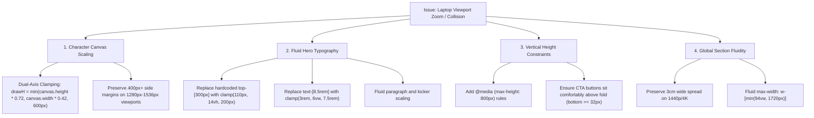

# Engineering Bug Report: Laptop Display Scaling & Viewport Collision (Stage 4)

**Document ID**: `BUG-2026-10-ST4-001`  
**Status**: Root Cause Identified • Resolution Plan Formulated  
**Branch**: `stage-4`  
**Date**: October 23, 2026  
**Author**: Abhimanyu Kanase (Data & AI Engineer)  

---

## 1. Executive Summary

When opening the portfolio on standard 13-inch to 15.6-inch laptop displays (1920×1080 resolution running OS display scaling at 125% or 150%), the hero section appears excessively "zoomed in":
1. The 60 FPS interactive character bust expands to occupy over 75% of the horizontal screen real estate.
2. The editorial name typography (`Abhimanyu`) and right-side title (`Life Portfolio`) directly collide with and overlap the character's face, neck, and shoulders.
3. The call-to-action buttons (`Resume`, `Let's Talk`) are pushed below the browser fold, with only their top rims visible.
4. When users zoom out to **63%** in their browser, the interface returns to its intended spacious, elegant layout.

---

## 2. Mathematical Root Cause Analysis: The 63% Zoom Phenomenon

### 2.1 The OS Scaling & Browser Chrome Reality
- **Physical vs. CSS Resolution**: Modern laptops commonly have a 1920×1080 physical panel configured by default to **125% or 150% DPI scaling** in Windows / macOS:
  $$\text{Effective CSS Width} = \frac{1920}{1.5} = 1280\text{px} \quad (\text{or } 1536\text{px at } 125\%)$$
  $$\text{Effective CSS Height} = \frac{1080}{1.5} = 720\text{px} \quad (\text{or } 864\text{px at } 125\%)$$
- **Browser Chrome Overhead**: Tabs, address bar, bookmarks bar, and system taskbars consume ~100px–130px of vertical space:
  $$\text{Actual Viewport Height } (H_{vp}) \approx 590\text{px} - 640\text{px}$$

### 2.2 Why 63% Zoom "Fixes" It
When a user presses `Ctrl + -` to reach **63% zoom** ($\approx \frac{1}{1.587}$):
$$\text{Scaled CSS Width} = \frac{1280}{0.63} \approx 2031\text{px}$$
$$\text{Scaled CSS Height} = \frac{620}{0.63} \approx 984\text{px}$$
At $2031\text{px} \times 984\text{px}$, the browser simulates a large 27-inch 1440p desktop monitor, providing the massive horizontal gutter space and vertical headroom designed for fixed-pixel layouts.

### 2.3 The Three Specific Code Defects

#### Defect A: Canvas Character Sizing Ignores Viewport Height (`CharacterTrackerCanvas.tsx`)
In `CharacterTrackerCanvas.tsx`:
```typescript
const imageAspect = 1920 / 1080; // 1.777
const canvasAspect = canvas.width / canvas.height;
const SCALE = 0.75;

if (canvasAspect > imageAspect) {
  drawW = canvas.width * SCALE;
  drawH = (canvas.width / imageAspect) * SCALE;
}
```
On a 1280×600 laptop viewport:
- $\text{canvasAspect} = \frac{1280}{600} = 2.13 > 1.777$.
- $\text{drawW} = 1280 \times 0.75 = 960\text{px}$.
- The character spans $960\text{px}$ across a $1280\text{px}$ screen (centered from $X = 160\text{px}$ to $X = 1120\text{px}$), leaving only $160\text{px}$ on either side.

#### Defect B: Fixed Pixel Offsets & Giant Typography (`Hero.tsx`)
In `Hero.tsx`:
```tsx
<div className="absolute top-[252px] ... lg:top-[300px] lg:left-16 max-w-xl ...">
  <h1 className="text-6xl sm:text-7xl md:text-8xl lg:text-[8.5rem] xl:text-[10rem] ...">
    Abhimanyu
  </h1>
  <p className="max-w-xl text-base ... lg:text-2xl ...">...</p>
</div>
```
- `top: 300px` places the text halfway down a 600px viewport.
- `text-[8.5rem]` (= 136px) + kicker + paragraph + buttons = ~430px block height.
- Total vertical reach = $300\text{px} + 430\text{px} = 730\text{px} > 600\text{px}$ viewport height $\rightarrow$ **Buttons clipped off-screen**.
- Left text boundary: $X \in [64\text{px}, 640\text{px}]$.
- Character boundary: $X \in [160\text{px}, 1120\text{px}]$.
- **Direct Collision Area**: Overlap of $480\text{px}$ directly over the face and collar.

#### Defect C: Absence of Vertical Media Queries & Fluid Clamping
The application relied on Tailwind horizontal breakpoints (`lg: 1024px`, `xl: 1280px`). Laptops satisfy `xl` in width ($1280\text{px} \ge 1280\text{px}$), which unintentionally activates giant desktop sizes without checking whether vertical height ($< 800\text{px}$) can accommodate them.

---

## 3. Comprehensive Resolution Plan



### Proposed Code Modifications
1. **`src/components/CharacterTrackerCanvas.tsx`**:
   - Re-architect canvas draw dimensions to bound scale by both width AND height.
   - Clamp the maximum character width on screens under 1600px width so the central character never exceeds $50\%$ of screen width.
2. **`src/components/Hero.tsx`**:
   - Replace fixed `top-[300px]` with fluid responsive positioning: `top-[clamp(110px,16vh,220px)]`.
   - Implement fluid CSS `clamp()` typography on `Abhimanyu` (`clamp(3.25rem, 6.2vw, 8rem)`) and `Life Portfolio` (`clamp(2.5rem, 4.8vw, 5.5rem)`).
   - Constrain bio text width to `max-w-md xl:max-w-lg` with fluid font sizing (`clamp(0.95rem, 1.15vw, 1.25rem)`).
   - Guarantee CTA button visibility above the fold on all screens with height $\ge 600\text{px}$.
3. **`src/components/ProfileBackground.tsx` & Main Page Sections**:
   - Apply fluid container limits `max-w-[min(94vw,1720px)]` to preserve wide architectural spread on 4K/1440p while scaling smoothly down to 13"-15" laptops.

---

## 4. Verification & Testing Matrix

| Viewport Profile | Physical Dimensions | Effective CSS Viewport | Expected Behavior |
| :--- | :--- | :--- | :--- |
| **Standard Laptop (150%)** | 1920×1080 (150% DPI) | 1280 × 600 px | Zero text-on-face collision; buttons visible above fold; clean margins. |
| **Medium Laptop (125%)** | 1920×1080 (125% DPI) | 1536 × 720 px | Balanced 3-column symmetry (Left Text - Character - Right Text). |
| **MacBook Retina (2x)** | 2560×1600 (Retina) | 1440 × 900 px | Crisp 60 FPS rendering, generous breathing room. |
| **Desktop 1440p / 4K** | 2560×1440 / 3840×2160 | 1920+ × 1080+ px | Full grand editorial spread (3cm wide layout preserved). |
